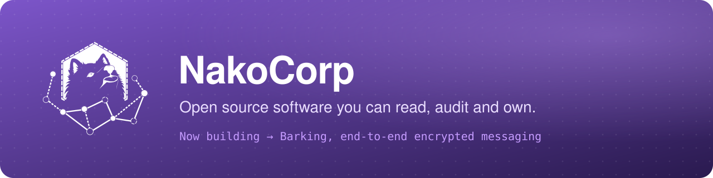
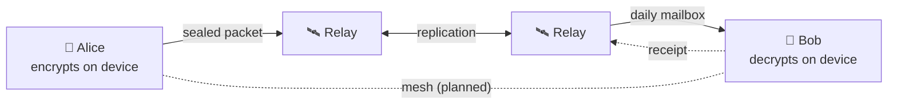

<p align="center">
  
</p>

<p align="center">
  <a href="https://www.nakocorp.com/"><b>nakocorp.com</b></a> ·
  <a href="https://github.com/nakocorp/barking"><b>Barking</b></a> ·
  <a href="https://github.com/nakocorp/barking/blob/main/LICENSE">AGPL-3.0</a>
</p>

NakoCorp is an open source software studio. We build tools that stay under your control: the code is public, your data stays yours, and nothing depends on our servers.

- **Transparent:** every line is public and auditable. No black boxes.
- **Decentralized:** anyone can run the infrastructure. No single company to trust, or to shut down.
- **Built to last:** open formats, reproducible builds, no vendor lock-in.

---

## 🐕 Barking

**End-to-end encrypted messaging without a phone number, without a central server, and eventually without the internet.**

Barking delivers messages through relays that anyone can run, and will later hop between nearby devices over Bluetooth, Wi-Fi and LoRa when there is no connection at all. Relays only ever see sealed packets addressed to mailboxes that change every day.

| | |
|---|---|
| 🔐 **Post-quantum E2E** | Double ratchet with a hybrid X25519 + ML-KEM-768 key exchange |
| 🕵️ **Minimal metadata** | No phone number, no account. Mailbox IDs rotate daily, relays never log IP addresses |
| 🌐 **No central server** | Self-hostable QUIC relays with S/Kademlia routing and replication |
| 📱 **Multi-device** | Up to 8 devices per identity, recoverable from a 24-word phrase |
| 🗄️ **Encrypted at rest** | Local history stored in SQLCipher |
| 📡 **Offline mesh** *(planned)* | Bluetooth LE, Wi-Fi and LoRa between nearby devices |

### How a message travels



Relays keep packets for 7 days, then drop them. They can't read the content and don't know who is talking to whom.

### Try it

The prototype ships a command-line client and the relay node, written in Rust.

```sh
git clone https://github.com/nakocorp/barking && cd barking
cargo build --release -p barking-cli -p barking-node
./target/release/barking init --name laptop
```

Want to help the network grow? Run a relay:

```sh
./target/release/barking-node init --config node.toml
./target/release/barking-node run --config node.toml
```

> [!WARNING]
> Barking is a prototype and has not been audited yet. Don't rely on it for sensitive communications.

### Roadmap

- [x] Encrypted 1:1 messaging, receipts, multi-device, CLI
- [x] Decentralized relays with replication
- [ ] iOS and Android apps
- [ ] Bluetooth / Wi-Fi / LoRa mesh
- [ ] Groups and media
- [ ] Independent security audit

---

## Get involved

- ⭐ Star [Barking](https://github.com/nakocorp/barking) to follow the project
- 🛰️ Run a relay and help the network grow
- 🐛 Open an issue or a pull request. Reviews of the cryptography are especially welcome
